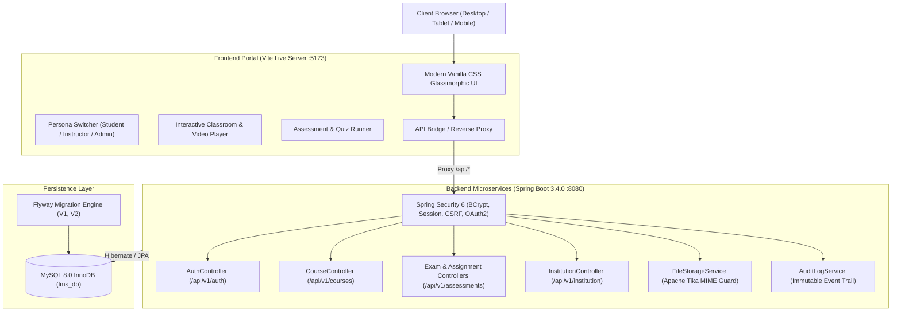

# Apex College Learning Management System (LMS)

[](https://spring.io/projects/spring-boot)
[](https://www.oracle.com/java/)
[](https://vitejs.dev/)
[](https://www.mysql.com/)
[](LICENSE)

An enterprise-grade, full-stack Learning Management System (LMS) engineered for higher education institutions. Apex College LMS delivers course management, interactive multimedia lecture delivery, automated assessment scoring, assignment evaluation workflows, institutional governance, and security audit logging.

---

## 🏛️ System Architecture



---

## ✨ Key Features & Capabilities

### 👨‍🎓 1. Student Learning Portal
- **Academic Dashboard**: High-level telemetry displaying GPA, completed degree credits, attendance percentage, and real-time deadline countdowns.
- **Interactive Video Classroom**: HTML5 lecture streaming, lecture notes drawer, downloadable course slides, and syllabus sidebar with dynamic progress tracking.
- **Hands-on Lab & Assignment Hub**: Multi-course assignment tracking with pending/submitted statuses and submission modals with Apache Tika file validation.
- **Examination Engine**: Timed multiple-choice assessments with automated scoring and instant question explanation reviews.

### 👩‍🏫 2. Instructor Academic Suite
- **Course & Syllabus Builder**: Create accredited courses, assign departments, upload syllabi, and organize multi-tiered module hierarchies.
- **Submissions Evaluation Queue**: Student lab queue featuring numerical grading sliders, rubric checklists, and qualitative feedback publishing.
- **Virtual Lecture Scheduling**: Integrated scheduler for synchronized video classes and office hours with attendance tracking.

### 🛡️ 3. Institutional Governance & Administration
- **Institutional Hierarchy**: Manage university faculties, academic terms (semesters/sessions), and department chairs.
- **Security Audit Trail**: Real-time immutable event log tracking authentications, privilege escalations, module publishing, and rate limit occurrences.
- **System Diagnostics**: Live telemetry probe evaluating API endpoint availability, response latency, and database pool health.

---

## 📁 Repository Structure

```
Learning Management System/
├── backend/                               # Spring Boot 3.4.0 Java Backend
│   ├── src/main/java/com/college/lms/
│   │   ├── assessment/                    # Quizzes, questions, exams, assignments
│   │   ├── audit/                         # AuditEvent entities, interceptors & listeners
│   │   ├── course/                        # Courses, modules, lessons, enrollments
│   │   ├── identity/                      # Users, roles, auth, security config, OAuth2
│   │   ├── institution/                   # Departments, academic terms, faculty
│   │   ├── shared/                        # Global exception handlers, DTOs, utilities
│   │   ├── storage/                       # Local/S3 storage service & Tika MIME guards
│   │   └── LmsApplication.java            # Spring Boot main entrypoint
│   ├── src/main/resources/
│   │   ├── application.yml                # Production configuration & secrets reference
│   │   ├── application-dev.yml            # Local development profile
│   │   └── db/migration/                  # Flyway database schema migrations
│   │       ├── V1__init_schema.sql        # Full DDL schema creation
│   │       └── V2__seed_roles_and_admin.sql # Roles (STUDENT, INSTRUCTOR, ADMIN) seed
│   ├── pom.xml                            # Maven dependencies & build lifecycle
│   └── mvnw / mvnw.cmd                    # Maven wrappers
├── frontend/                              # Reactive Single Page Application
│   ├── public/
│   │   ├── courses/                       # High-definition course cover media
│   │   └── favicon.svg                    # Institution brand favicon
│   ├── src/
│   │   ├── api.js                         # API Bridge & health diagnostics
│   │   ├── mockData.js                    # Rich mock dataset aligning with backend DTOs
│   │   ├── style.css                      # Design system (Dark Mode, Glassmorphism)
│   │   └── main.js                        # Multi-role routing & view controllers
│   ├── index.html                         # Entry HTML with SEO metadata
│   ├── vite.config.js                     # Vite dev server configuration with proxy
│   └── package.json                       # Frontend dependencies & scripts
├── scripts/
│   └── setup_database.sql                 # Database initialization & user permissions script
├── .env.example                           # Template environment variables
└── README.md                              # Project documentation
```

---

## 🚀 Quick Start Guide

### Prerequisites
Make sure the following tools are installed on your machine:
- **Java Development Kit (JDK) 21** or higher (`java -version`)
- **Node.js 18+** and **npm** (`node -v`, `npm -v`)
- **MySQL Server 8.0+** (`mysql --version`)
- **Git** (`git --version`)

---

### Step 1: Database Setup

1. Open your MySQL command-line client or MySQL Workbench as `root`:
2. Run the provided database initialization script [scripts/setup_database.sql](scripts/setup_database.sql):
   ```sql
   -- Create Database
   CREATE DATABASE IF NOT EXISTS lms_db
       CHARACTER SET utf8mb4
       COLLATE utf8mb4_unicode_ci;

   -- Create Least-Privilege Application User
   CREATE USER IF NOT EXISTS 'lms_user'@'localhost' IDENTIFIED BY 'LmsDevPass2024!';

   -- Grant Necessary Permissions
   GRANT SELECT, INSERT, UPDATE, DELETE,
         CREATE, ALTER, DROP, INDEX, REFERENCES
   ON lms_db.* TO 'lms_user'@'localhost';

   FLUSH PRIVILEGES;
   ```

---

### Step 2: Run the Spring Boot Backend

1. Navigate to the backend directory:
   ```bash
   cd backend
   ```
2. (Optional) Set custom database credentials if different from the default:
   ```bash
   # Windows PowerShell
   $env:DB_PASSWORD="LmsDevPass2024!"
   
   # Linux / macOS
   export DB_PASSWORD="LmsDevPass2024!"
   ```
3. Compile and launch the Spring Boot service:
   ```bash
   # Windows
   .\mvnw.cmd spring-boot:run -Dspring-boot.run.arguments=--spring.profiles.active=dev

   # Linux / macOS
   ./mvnw spring-boot:run -Dspring-boot.run.arguments=--spring.profiles.active=dev
   ```
4. The backend will start on **`http://localhost:8080`**.
   - **Swagger UI API Explorer**: [http://localhost:8080/swagger-ui/index.html](http://localhost:8080/swagger-ui/index.html)
   - **OpenAPI JSON Spec**: `http://localhost:8080/v3/api-docs`
   - **Actuator Health Probe**: `http://localhost:8080/actuator/health`

---

### Step 3: Run the Frontend Live Server

1. In a new terminal window, navigate to the frontend directory:
   ```bash
   cd frontend
   ```
2. Install dependencies:
   ```bash
   npm install
   ```
3. Start the Vite live development server:
   ```bash
   npm run dev
   ```
4. Open your browser and navigate to **`http://localhost:5173/`**.

---

## 🔑 Default Seed Accounts

The Flyway migration script (`V2__seed_roles_and_admin.sql`) automatically populates standard roles and an initial administrator account:

| Role | Email | Default Password | Access Level |
| :--- | :--- | :--- | :--- |
| **Admin** | `admin@apexcollege.edu` | `Admin@123456` | Full institutional governance & audit logs |
| **Instructor** | `prof.elena@apexcollege.edu` | *(Dev demo)* | Curriculum creation & grading queue |
| **Student** | `student@apexcollege.edu` | *(Dev demo)* | Enrolled degree courses & lab submissions |

> [!WARNING]
> Change the default administrator password immediately prior to deploying into any production or public-facing environment.

---

## ⚙️ Environment Configuration

The application reads configurations from environment variables or a `.env` file based on `.env.example`:

| Variable | Description | Default |
| :--- | :--- | :--- |
| `DB_URL` | JDBC MySQL connection URL | `jdbc:mysql://localhost:3306/lms_db` |
| `DB_USERNAME` | MySQL database user | `lms_user` |
| `DB_PASSWORD` | MySQL user password | `changeme` |
| `CORS_ALLOWED_ORIGINS` | Permitted frontend origins | `http://localhost:5173` |
| `UPLOAD_BASE_PATH` | Local file uploads directory | `./uploads` |
| `EMAIL_ENABLED` | Toggle email dispatching | `false` (logs to console in dev) |
| `GOOGLE_CLIENT_ID` | OAuth2 Google Client ID | `PLACEHOLDER_SET_IN_ENV` |
| `GOOGLE_CLIENT_SECRET` | OAuth2 Google Client Secret | `PLACEHOLDER_SET_IN_ENV` |

---

## 🔒 Security Best Practices Implemented

- **Password Hashing**: BCrypt with cost factor 12 (~300ms per computation) to resist brute-force dictionary attacks.
- **Content-Type Validation**: Apache Tika inspects binary byte signatures on uploaded files to prevent spoofed file extensions.
- **Rate Limiting**: Bucket4j token bucket algorithm protects critical authentication and AI endpoints against brute force attacks.
- **XSS & Injection Protection**: Jsoup sanitizes rich user text in course discussion forums.
- **Cross-Site Request Forgery (CSRF)**: Double-submit cookie pattern protecting state-changing actions.
- **Strict Role-Based Access Control (RBAC)**: Fine-grained method security using `@PreAuthorize` across student, instructor, and admin domains.

---

## 📄 License

This project is open-source under the [MIT License](LICENSE).
